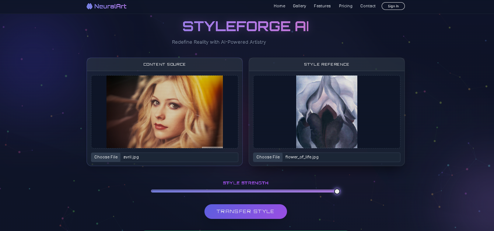

# 🎨 Neural Style Transfer with AdaIN

A deep learning web application that transforms ordinary images into artistic creations by transferring visual styles from paintings, sketches, and other artwork while preserving the original image's content.

Built using **PyTorch, VGG-19, Adaptive Instance Normalization (AdaIN), and Flask**.

## ✨ Features

- **Neural Style Transfer:** Apply artistic styles to content images.
- **Adjustable Style Strength:** Control the intensity of style transfer using a slider.
- **Image Upload:** Upload your own content and style images.
- **Example Gallery:** Explore sample content, style, and generated output images.
- **Download Results:** Save generated stylized images.
- **Web Interface:** Interactive browser-based application built with Flask.

## 🖼️ Application Preview

The application allows users to select a content image, choose a style reference, adjust style strength, and generate a stylized output.

<!-- Add a screenshot of your working web application here -->


## 🧠 How It Works

The project uses **Adaptive Instance Normalization (AdaIN)** to transfer artistic style statistics from a style image to the features of a content image.

The architecture consists of three main components:

1. **VGG-19 Encoder:** Extracts visual features from content and style images. Its parameters are frozen during decoder training.
2. **AdaIN Operation:** Aligns the channel-wise mean and standard deviation of content features with those of style features.
3. **Decoder:** Reconstructs the stylized image from the transformed feature representation.

### Workflow

1. Load the content and style images.
2. Extract their features using the VGG encoder.
3. Apply AdaIN to transfer style statistics.
4. Decode the transformed features into an image.
5. Blend the transformed representation with the original content features according to the selected style strength.
6. Display and optionally download the result.

## 🛠️ Tech Stack

- **Language:** Python
- **Deep Learning:** PyTorch, Torchvision
- **Model:** VGG-19 encoder and trainable decoder
- **Style Transfer:** Adaptive Instance Normalization (AdaIN)
- **Web Framework:** Flask
- **Frontend:** HTML, CSS, Bootstrap
- **Image Processing:** Pillow, NumPy

## 📁 Project Structure

```text
NST_Code/
├── app.py
├── train_fixed.py
├── requirements.txt
├── Procfile
├── vgg_normalised.pth
├── adain_algo.png
├── content_data/
├── style_data/
├── examples/
├── experiment/
│   ├── decoder_final.pth
│   └── experiment1/
├── static/
├── templates/
│   └── index.html
├── utils/
│   ├── models.py
│   └── utils.py
└── README.md
```

## ⚙️ Installation and Setup

### 1. Clone the repository

```bash
git clone https://github.com/Saif-codes-cell/AdaIN-Neural-Style-Transfer.git
cd AdaIN-Neural-Style-Transfer
```

### 2. Create a virtual environment

```bash
python -m venv venv
```

Activate it on Windows:

```powershell
.\venv\Scripts\Activate.ps1
```

### 3. Install dependencies

```bash
pip install -r requirements.txt
```

### 4. Run the application

```bash
python app.py
```

Open the local URL displayed in your terminal, normally:

```text
http://127.0.0.1:5000
```

## 📌 Model Files

The application uses pretrained VGG weights and a trained decoder checkpoint.

- `vgg_normalised.pth` — pretrained VGG feature extractor weights.
- `experiment/decoder_final.pth` — trained decoder weights used for image generation.

Ensure both files are present at the paths expected by the application.

## 🎯 Project Objectives

- Understand the fundamentals of neural style transfer.
- Explore feature extraction using convolutional neural networks.
- Implement Adaptive Instance Normalization.
- Train and load a decoder network using PyTorch.
- Integrate a deep learning model into a Flask web application.
- Build an interactive interface for image stylization.

## 🚀 Future Improvements

- Deploy the application on a public hosting platform.
- Improve inference speed and memory efficiency.
- Add more example styles and compare outputs.
- Evaluate the results across a broader variety of content and style images.

## 👨‍💻 Author

**Saif Chogle**

GitHub: [Saif-codes-cell](https://github.com/Saif-codes-cell)

## 📄 Acknowledgements

Developed as part of an AI/ML major project based on Neural Style Transfer with Adaptive Instance Normalization (AdaIN).